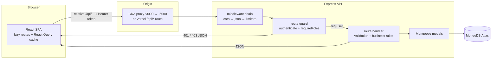
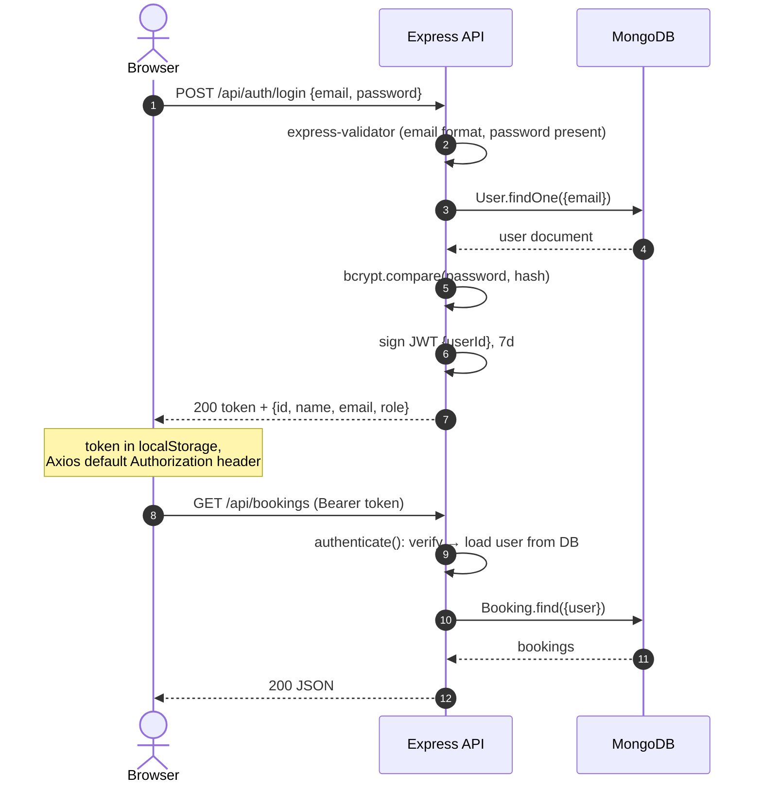
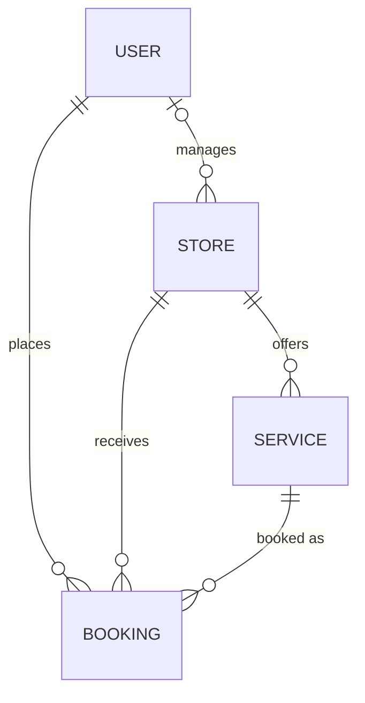

# MallBook

A shopping-mall booking system: customers discover stores and services, reserve a
time slot, and manage their bookings; store managers manage their own store;
admins see analytics and manage accounts and roles.

MERN stack — React 18 (Create React App), Express 4, MongoDB with Mongoose 7.

---

## Contents

- [Features](#features)
- [Tech stack](#tech-stack)
- [Architecture](#architecture)
- [Request lifecycle](#request-lifecycle)
- [Project structure](#project-structure)
- [Data model](#data-model)
- [Domain rules](#domain-rules)
- [API](#api)
- [Getting started](#getting-started)
- [Scripts](#scripts)
- [Testing & known limitations](#testing--known-limitations)
- [Roadmap](#roadmap)

---

## Features

**Customers**

- Browse and filter stores by floor, category and free-text search
- Browse services with per-weekday opening hours
- Book a slot with real availability, overlap and capacity checks
- View and cancel their own bookings

**Store managers**

- Read and edit only the store they are assigned to, and its services
- See that store's bookings and move them through their statuses

**Admins**

- Analytics: totals, revenue for today/week/month, status breakdown, top services
- All bookings with filters and pagination
- User management: search accounts and reassign roles from the UI

**Cross-cutting**

- JWT authentication, bcrypt password hashing, server-side validation
- Tiered rate limiting, login-attempt throttling
- Route-level code splitting, React Query caching, Tailwind CSS
- Compound MongoDB indexes derived from the queries the API actually runs

---

## Tech stack

| Layer     | Choices                                                                                                                   |
| --------- | ------------------------------------------------------------------------------------------------------------------------- |
| Front end | React 18, React Router 6, React Query 3, Axios, Tailwind CSS 3, Framer Motion 10, Recharts 2, React Icons, React Toastify |
| Back end  | Node 18+, Express 4, Mongoose 7, jsonwebtoken, bcryptjs, express-validator, express-rate-limit, moment                    |
| Database  | MongoDB (local or Atlas)                                                                                                  |
| Tooling   | Create React App 5, PostCSS + Autoprefixer, nodemon, concurrently                                                         |

---

## Architecture

Three processes in development: the CRA dev server (`:3000`), the Express API
(`:5000`), and MongoDB. The browser only ever talks to the CRA server; CRA proxies
`/api/*` to Express, so the front end uses relative URLs and there is no CORS
problem in development. In production Vercel routes `/api/*` to the Express
function and serves the built bundle for everything else (deep links need the
rewrite noted under [Deployment](#deployment)).



**Layers, and why they exist**

- **Middleware chain** — CORS allowlist from `CLIENT_URL`, a 1 MB JSON body cap,
  a global limiter (100 requests / 15 min per IP), then a per-router limiter
  (30 / min). `trust proxy` is enabled in production so limits apply per client,
  not per load balancer.
- **Route guards** — `authenticate()` verifies the JWT and loads the user from
  MongoDB; `requireRoles(...)` compares `user.role`. The token deliberately does
  **not** carry the role, so a demotion applies on the next request instead of
  when the token expires.
- **Handlers** — `express-validator` for shape, then domain rules (availability,
  overlap, capacity, ownership). Each handler answers with one JSON shape.
- **Models** — Mongoose schemas own the invariants that must survive any caller:
  enums, required fields, the unique email index, compound indexes.

**Front-end shape**

`src/index.js` mounts `QueryClientProvider` → `BrowserRouter` → `AuthProvider` →
`App`. `App.js` lazy-loads every page behind one `Suspense`, and guards routes
with `PrivateRoute` / `AdminRoute`. Screens use `useQuery` for reads and
`useMutation` + `invalidateQueries` for writes, so a cancellation refreshes both
the booking list and the dashboard.

---

## Request lifecycle

**An authenticated read** — `GET /api/admin/dashboard`:

1. Browser sends the request with `Authorization: Bearer <jwt>`, which Axios
   attaches globally after login.
2. CRA proxy forwards it to Express.
3. `cors` checks the `Origin` against `CLIENT_URL`; `express.json` parses the body;
   the global limiter counts the request.
4. The `/api/admin` router runs `apiLimiter`, then the `adminAuth` guard.
5. `adminAuth` → `authenticate()` strips `Bearer`, verifies the signature and
   expiry, loads the user from MongoDB and attaches `req.user`.
6. `requireRoles('admin')` compares `req.user.role`; a non-admin gets exactly one
   `403` response and the handler never runs.
7. The handler runs its aggregations, populates the recent bookings, and returns
   JSON.
8. Any thrown error reaches the shared `errorHandler`, so failures are JSON with a
   status code — never a stack trace.

**Login, and what the client keeps**



The login response is the only place the client learns its role. The server never
trusts it back: every request re-derives the role from the database.

**A write with domain rules** — `POST /api/bookings`:

1. `auth` guard → `req.user`.
2. `express-validator`: valid Mongo id, ISO-8601 date, `HH:mm` time, people ≥ 1,
   request text ≤ 500 chars.
3. Load the service and its store; reject missing or inactive.
4. Reject past dates and weekdays the service is closed.
5. Convert to minutes and reject a slot that runs outside opening hours.
6. Load that day's `pending`/`confirmed` bookings for the service and test
   interval overlap — `startA < endB && startB < endA`, not string equality.
7. Enforce capacity across overlapping bookings; capacity 1 means the slot is
   simply taken.
8. Charge `price × people`, derive `endTime` from `time + duration`, insert.
9. Populate and return `201`.

---

## Project structure

```
backend/
  middleware/
    auth.js            authenticate(), requireRoles(), adminAuth, storeManagerAuth
    rateLimit.js       global, per-API and auth-specific limiters
    errorHandler.js    single JSON error response
  models/
    User.js            customers, store managers, admins
    Store.js           mall store, floor, hours, assigned manager
    Service.js         bookable service offered by a store
    Booking.js         reservation with slot, price and status
  routes/
    auth.js  users.js  stores.js  services.js  bookings.js  admin.js
  utils/
    storeAccess.js     canManageStore() ownership check
    regex.js           escapes user input used in $regex
    dns.js             opt-in resolver override for SRV URIs
  server.js            app wiring, CORS, static build, graceful shutdown
  seed.js              demo data (destructive)

frontend/
  public/index.html
  src/
    App.js                     lazy routes + route guards
    index.js                   QueryClientProvider, Router, AuthProvider
    index.css                  Tailwind layers + component classes
    components/
      admin/     AdminDashboard.js, AdminUsers.js, AdminTabs.js
      auth/      Login.js, Register.js
      bookings/  BookingForm.js, MyBookings.js
      common/    LoadingSpinner.js
      dashboard/ Dashboard.js
      layout/    Navbar.js, Footer.js
      pages/     Home.js
      services/  Services.js, ServiceDetail.js
      stores/    Stores.js, StoreDetail.js
    contexts/AuthContext.js    token, user, login/logout, cache clearing
    utils/currency.js          INR formatting
  tailwind.config.js
  postcss.config.js
```

---

## Data model



**User** — `name`, `email` (unique, lowercased), `password` (bcrypt hash, never
returned), `phone`, `role` (`customer | store_manager | admin`, default
`customer`), `avatar`, `isVerified`, `preferences`, `createdAt`.

**Store** — `name`, `description`, `category`, `location {floor, unit,
coordinates}`, `contact {phone, email, website}`, `manager` (ref User), `logo`,
`images`, `isActive`, `operatingHours` per weekday, `rating {average, count}`,
`features`.

**Service** — `name`, `description`, `category`, `store` (ref Store), `price`
(INR), `duration` (minutes), `capacity`, `images`, `isActive`, `availability` per
weekday, `features`, `rating {average, count}`.

**Booking** — `user`, `service`, `store`, `date` (start of the booking day),
`time` (`HH:mm`), `endTime`, `duration`, `numberOfPeople`, `totalPrice`, `status`
(`pending | confirmed | completed | cancelled | no_show`), `paymentStatus`,
`paymentMethod`, `specialRequests`, `notes`, `cancellationReason`, `cancelledBy`.

### Indexes and why they exist

| Collection | Index                       | Serves                             |
| ---------- | --------------------------- | ---------------------------------- |
| User       | `{ email }` unique          | Login lookup, duplicate prevention |
| Booking    | `{ service, date, status }` | Slot-conflict check during booking |
| Booking    | `{ store, date: -1 }`       | Store dashboard and admin filters  |
| Booking    | `{ user, date: -1 }`        | "My bookings"                      |
| Store      | `{ isActive, category }`    | Public catalogue + category filter |
| Store      | `{ location.floor }`        | Floor filter and floor list        |
| Service    | `{ isActive, category }`    | Public catalogue + category filter |
| Service    | `{ store, isActive }`       | Store page and booking validation  |

Each one mirrors a query shape in the routes; none are speculative.

---

## Domain rules

**Booking a slot**

- Booking dates are normalised to local midnight, and each day-scoped query is
  bounded to that calendar day (dashboard and admin filters use
  `[start, next midnight)`), so a 23:59 booking cannot leak into the following day.
- Conflict detection compares **intervals in minutes**, so a 60-minute service
  booked at 10:00 blocks 10:30 even though the strings differ.
- Capacity is summed across overlapping bookings; `capacity = 1` behaves as a
  single-slot service.
- Only `pending` and `confirmed` bookings block a slot. Cancelled and completed
  ones do not.
- Revenue counts only `confirmed` and `completed`. Cancelled bookings are excluded
  from revenue and from "top services", but still appear in the status breakdown.

**Roles are not enough on their own**

| Action                         | Customer | Store manager | Admin |
| ------------------------------ | -------- | ------------- | ----- |
| Create booking                 | own      | own           | own   |
| Read booking                   | own      | own store     | any   |
| Cancel booking                 | own      | own store     | any   |
| Change booking status          | —        | own store     | any   |
| Create / delete store          | —        | —             | yes   |
| Edit store                     | —        | own store     | any   |
| Create / edit / delete service | —        | own store     | any   |
| List users, change roles       | —        | —             | yes   |

"Own store" means `Store.manager === user._id`, checked by `canManageStore()`. A
`store_manager` role with no store attached can do nothing store-scoped — which is
the correct default.

**Guards against lockout**

- An admin cannot change their own role.
- The last remaining admin cannot be demoted or deleted.
- Deleting a manager first unsets `manager` on the stores they managed.
- Services with bookings cannot be deleted (deactivate instead), so no booking is
  left pointing at a missing service.

---

## API

All responses are JSON. Success returns the resource or `{ "success": true, ... }`.
Errors return `{ "success": false, "message": "..." }`, or
`{ "success": false, "errors": [...] }` for validation failures.

| Method | Path                           | Access                      | Notes                                          |
| ------ | ------------------------------ | --------------------------- | ---------------------------------------------- |
| GET    | `/api/health`                  | public                      | Liveness, excluded from rate limiting          |
| POST   | `/api/auth/register`           | public                      | Always creates a `customer`; 5 failed / 15 min |
| POST   | `/api/auth/login`              | public                      | Returns token + user; 5 failed / 15 min        |
| GET    | `/api/auth/user`               | user                        | Current profile incl. role                     |
| PUT    | `/api/auth/profile`            | user                        | Name, phone, preferences                       |
| GET    | `/api/users`                   | admin                       | `?role=&search=`                               |
| GET    | `/api/users/:id`               | admin                       |                                                |
| PUT    | `/api/users/:id`               | admin                       | Role changes; self and last-admin guarded      |
| DELETE | `/api/users/:id`               | admin                       | Unassigns their stores                         |
| GET    | `/api/stores`                  | public                      | `?category=&floor=&search=`                    |
| GET    | `/api/stores/categories`       | public                      | Distinct categories                            |
| GET    | `/api/stores/floors`           | public                      | Distinct floors, sorted                        |
| GET    | `/api/stores/:id`              | public                      | Store + its active services                    |
| POST   | `/api/stores`                  | admin                       |                                                |
| PUT    | `/api/stores/:id`              | owner / admin               |                                                |
| DELETE | `/api/stores/:id`              | admin                       | Blocked while active services exist            |
| GET    | `/api/services`                | public                      | `?category=&store=&search=`                    |
| GET    | `/api/services/categories`     | public                      |                                                |
| GET    | `/api/services/:id`            | public                      | Includes store contact + hours                 |
| POST   | `/api/services`                | owner / admin               | Store must be the caller's                     |
| PUT    | `/api/services/:id`            | owner / admin               |                                                |
| DELETE | `/api/services/:id`            | owner / admin               | Blocked while bookings exist                   |
| POST   | `/api/bookings`                | user                        | Overlap, capacity, hours validated             |
| GET    | `/api/bookings`                | user                        | Caller's own bookings                          |
| GET    | `/api/bookings/store/:storeId` | owner / admin               | Store's bookings                               |
| GET    | `/api/bookings/:id`            | owner / manager / admin     |                                                |
| PUT    | `/api/bookings/:id/cancel`     | owner / manager / admin     | Reason ≤ 500 chars                             |
| PUT    | `/api/bookings/:id/status`     | manager (own store) / admin | Status enum enforced                           |
| GET    | `/api/admin/dashboard`         | admin                       | Totals, revenue windows, charts                |
| GET    | `/api/admin/bookings`          | admin                       | `?status=&date=&store=&service=&page=&limit=`  |
| GET    | `/api/admin/reports`           | admin                       | `?startDate=&endDate=`                         |

---

## Getting started

**Prerequisites:** Node 18+, npm, and either a local MongoDB or an Atlas cluster.

```bash
git clone https://github.com/srv-23/mallbook.git
cd mallbook
npm run install:all          # root + backend + frontend
copy .env.example .env       # Windows;  cp .env.example .env  elsewhere
```

Edit `.env` — the backend reads it from the repository root. The server refuses to
start without `JWT_SECRET` rather than falling back to a hard-coded secret.

| Variable                                       | Required | Default                              | Purpose                                             |
| ---------------------------------------------- | -------- | ------------------------------------ | --------------------------------------------------- |
| `MONGODB_URI`                                  | yes      | —                                    | Local or Atlas connection string                    |
| `JWT_SECRET`                                   | yes      | —                                    | Token signing key; startup fails without it         |
| `PORT`                                         | no       | `5000`                               | API port                                            |
| `NODE_ENV`                                     | no       | `development`                        | Enables `trust proxy` and static serving            |
| `CLIENT_URL`                                   | no       | `http://localhost:3000`              | Allowed origins, comma-separated                    |
| `DNS_SERVERS`                                  | no       | system                               | Resolver override for SRV URIs, see Troubleshooting |
| `SEED_ADMIN_EMAIL` / `SEED_ADMIN_PASSWORD`     | no       | `admin@mall.com` / `Admin@12345`     | Seeded admin                                        |
| `SEED_MANAGER_EMAIL` / `SEED_MANAGER_PASSWORD` | no       | `manager@mall.com` / `Manager@12345` | Seeded manager                                      |
| `SEED_CUSTOMER_PASSWORD`                       | no       | `Customer@12345`                     | Password for the six demo customers                 |

The front end needs no environment variables: it calls relative `/api` paths and
`frontend/package.json` proxies them to `http://localhost:5000`.

Then seed and run:

```bash
npm run seed     # destructive — see below
npm run dev      # API on :5000, UI on :3000
```

**Demo accounts** created by the seed:

```
admin@mall.com    / Admin@12345     admin  — analytics, users, roles
manager@mall.com  / Manager@12345   store_manager — manages all 20 seeded stores
aarav@example.com / Customer@12345  customer (5 more customers share this password)
```

**What the seed creates:** 8 users (1 admin, 1 manager, 6 customers), 20 stores
across three floors (7 / 6 / 7), 20 services (one per store) and 15 bookings spread
from 9 days ago to 5 days ahead with every status represented, so the dashboard,
charts and Users screen are populated on first run.

> **Seeding is destructive.** It deletes all bookings, stores and services and
> recreates the demo accounts. Never run it against a database with real data.

---

## Scripts

| Command                       | From        | Does                                    |
| ----------------------------- | ----------- | --------------------------------------- |
| `npm run dev`                 | root        | API (nodemon) + UI (CRA) together       |
| `npm run server:dev`          | root        | API only (nodemon)                      |
| `npm run server:start`        | root        | API only (plain `node`)                 |
| `npm run client:dev`          | root        | UI only                                 |
| `npm run seed`                | root        | Reseed demo data                        |
| `npm run install:all`         | root        | Install root, backend and frontend deps |
| `npm run client:build`        | root        | Production build of the UI              |
| `npm start` / `npm run dev`   | `backend/`  | Run API / with nodemon                  |
| `npm start` / `npm run build` | `frontend/` | CRA dev server / production build       |

---

## Testing & known limitations

There is no automated test suite. Verification so far is manual: the production
build compiles without warnings, every backend file passes `node --check`, and the
flows were exercised against a seeded database — login, role changes, cancellation
and the guard rejection paths.

Known limitations, all of which a reviewer should assume are real:

- **Slot race condition** — the conflict check reads, then inserts. Two concurrent
  requests can both pass. The fix is a unique partial index on active slots or a
  transaction.
- **Timezone** — booking dates are stored at local midnight, so clients in negative
  UTC offsets can see a one-day shift.
- **No refresh tokens** — a 7-day access token in `localStorage`; no rotation or
  revocation list. Logout deletes the token locally only.
- **In-memory rate limiting** — limits are per process, so they do not hold across
  multiple instances.
- **No audit trail** — role changes and deletions are not logged.
- **No soft deletes** — deleting a user leaves their bookings in place; the admin
  view renders "Deleted user".
- **No pagination on public lists** — store and service catalogues return
  everything (fine at seed scale, not at real scale).
- **Seeding is destructive** and has no dry-run mode.

---

## Roadmap

- Automated tests: Jest + Supertest for the API guards and booking rules
- Slot uniqueness enforced by a partial index plus a transaction
- Refresh tokens with rotation, and httpOnly cookies instead of `localStorage`
- Audit log for role and permission changes
- Pagination and cursor support for public catalogues
- Store images and service gallery uploads (currently URL fields)

---

## License

MIT. Author: Saurabh Chaurasia.
